# Diagrams (ROADMAP M8.1)

One per requirement of the brief (semantic model §14). Re-generate with `npm run diagrams` (see `tools/export-diagrams.cjs`); the live page is [`diagrams.html`](../../diagrams.html).

## The live view

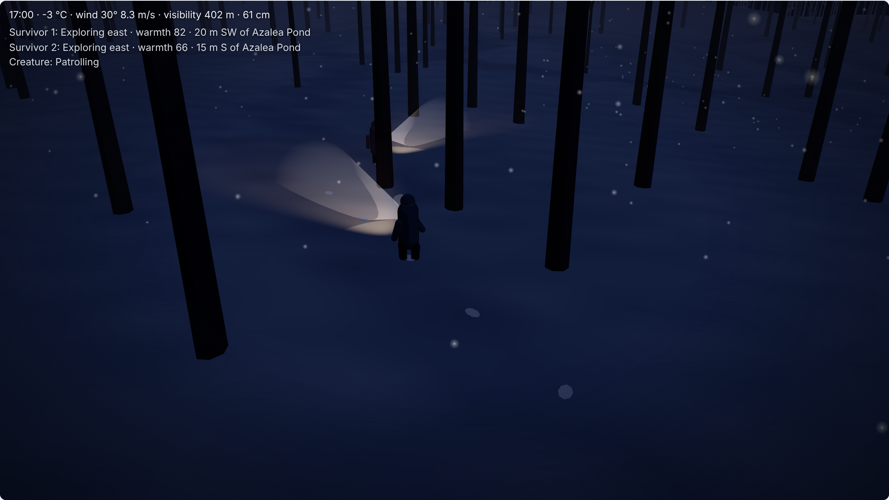

Third-person view of a round at 17:00: fog from the observed visibility, LiDAR trees, the creature of roots.

## 1. The baseline, from a semantic model

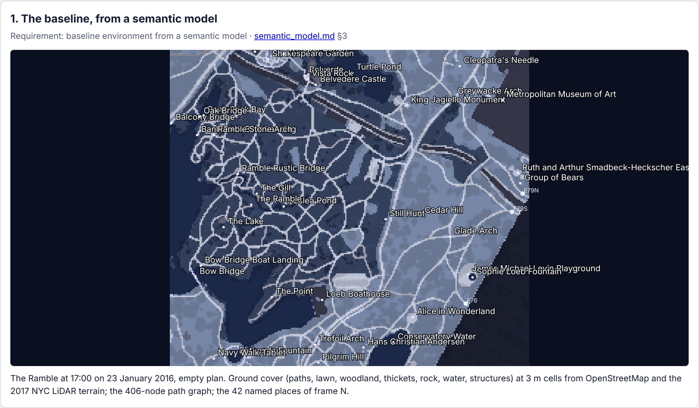

The Ramble at 17:00 on 23 January 2016, empty plan. Ground cover (paths, lawn, woodland, thickets, rock, water, structures) at 3 m cells from OpenStreetMap and the 2017 NYC LiDAR terrain; the 406-node path graph; the 42 named places of frame N.

## 2. Location: one occupant in every frame

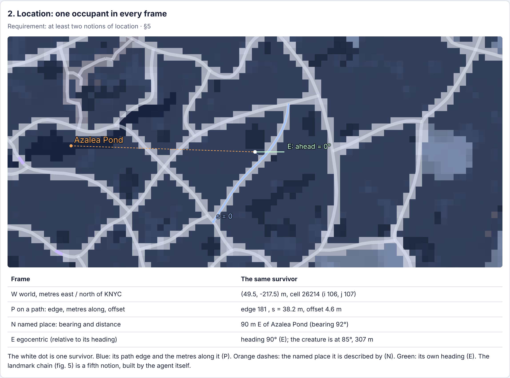

The white dot is one survivor. Blue: its path edge and the metres along it (P). Orange dashes: the named place it is described by (N). Green: its own heading (E). The landmark chain (fig. 5) is a fifth notion, built by the agent itself.

## 3. Distance: four ways apart, and which axioms hold

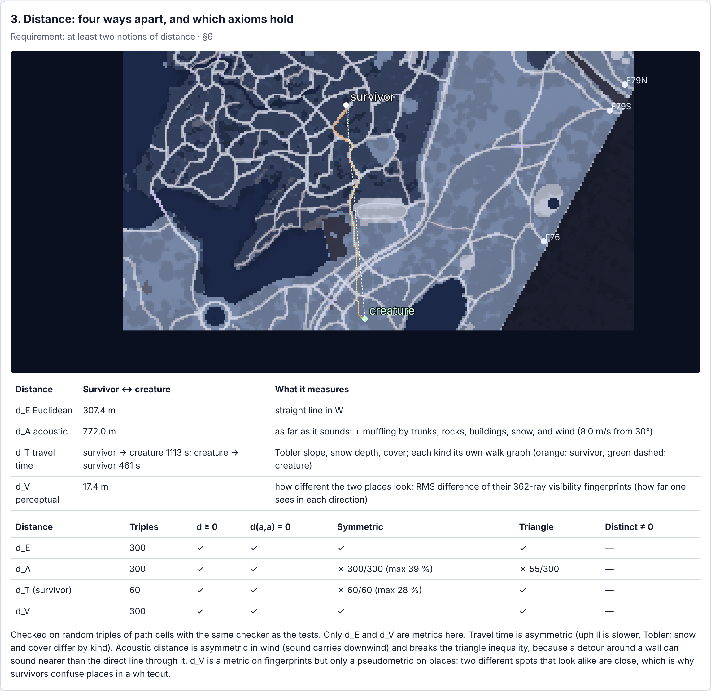

Checked on random triples of path cells with the same checker as the tests. Only d_E and d_V are metrics here. Travel time is asymmetric (uphill is slower, Tobler; snow and cover differ by kind). Acoustic distance is asymmetric in wind (sound carries downwind) and breaks the triangle inequality, because a detour around a wall can sound nearer than the direct line through it. d_V is a metric on fingerprints but only a pseudometric on places: two different spots that look alike are close, which is why survivors confuse places in a whiteout.

## 4. Limited knowledge: each agent's own map

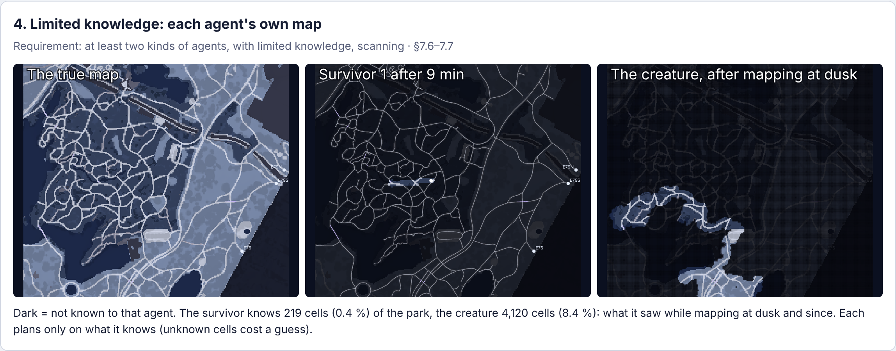

Dark = not known to that agent. The survivor knows 219 cells (0.4 %) of the park, the creature 4,120 cells (8.4 %): what it saw while mapping at dusk and since. Each plans only on what it knows (unknown cells cost a guess).

## 5. Spatial memory: landmarks, and a dead end avoided

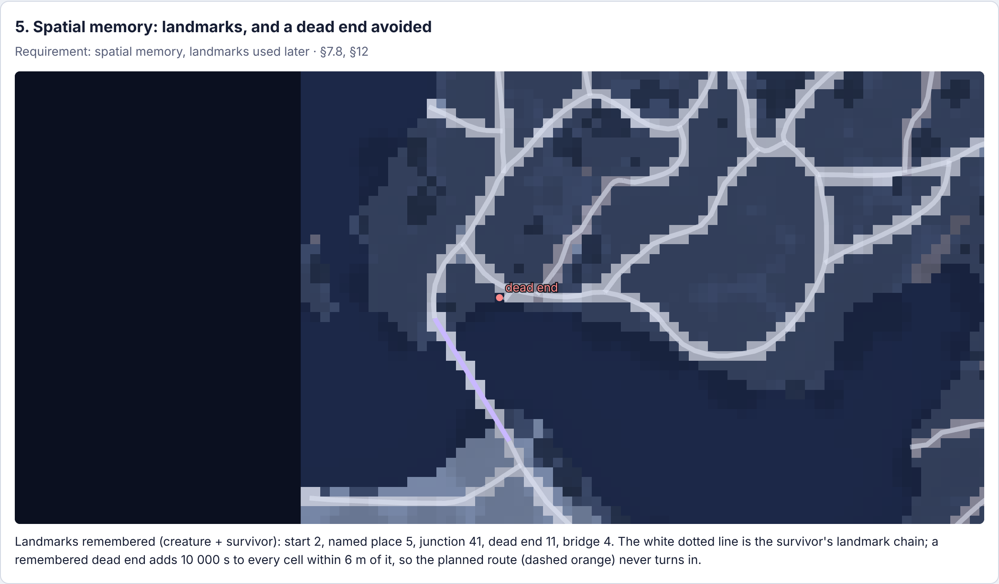

Landmarks remembered (creature + survivor): start 2, named place 5, junction 41, dead end 11, bridge 4. The white dotted line is the survivor's landmark chain; a remembered dead end adds 10 000 s to every cell within 6 m of it, so the planned route (dashed orange) never turns in.

## 6. Goals with measurable metrics

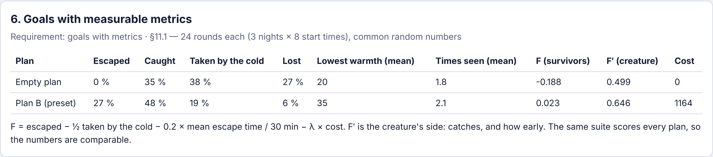

F = escaped − ½ taken by the cold − 0.2 × mean escape time / 30 min − λ × cost. F′ is the creature's side: catches, and how early. The same suite scores every plan, so the numbers are comparable.

## 7. Planning with limited knowledge

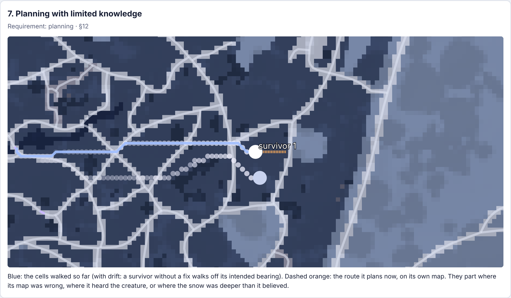

Blue: the cells walked so far (with drift: a survivor without a fix walks off its intended bearing). Dashed orange: the route it plans now, on its own map. They part where its map was wrong, where it heard the creature, or where the snow was deeper than it believed.

## 8. Partial observability: vision shrinks with the storm

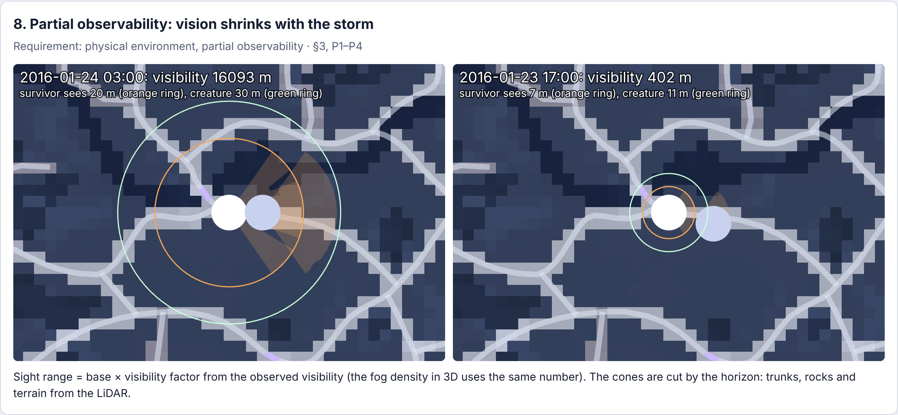

Sight range = base × visibility factor from the observed visibility (the fog density in 3D uses the same number). The cones are cut by the horizon: trunks, rocks and terrain from the LiDAR.

## 9. Many agents consuming space

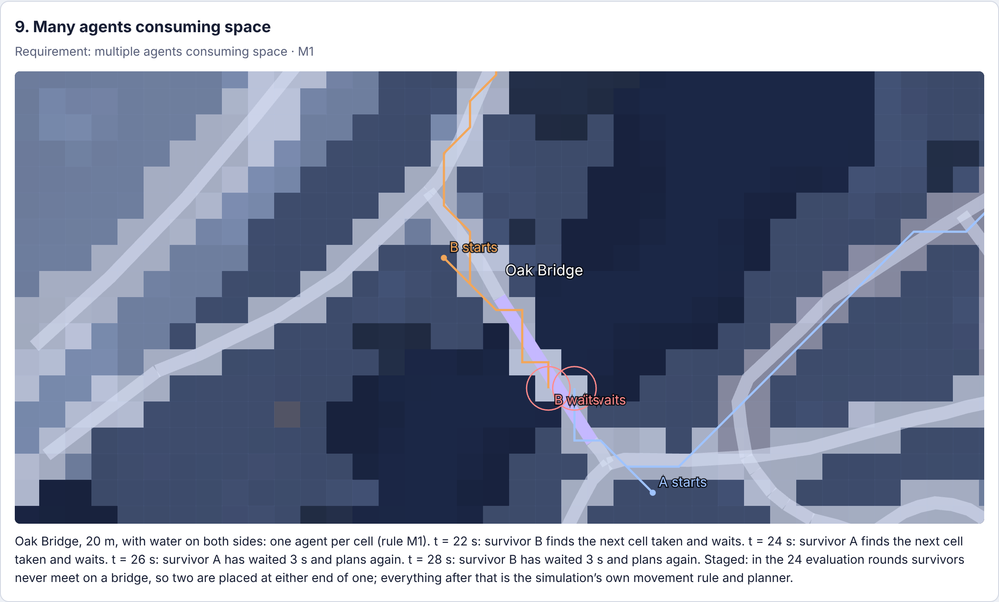

Oak Bridge, 20 m, with water on both sides: one agent per cell (rule M1). t = 22 s: survivor B finds the next cell taken and waits. t = 24 s: survivor A finds the next cell taken and waits. t = 26 s: survivor A has waited 3 s and plans again. t = 28 s: survivor B has waited 3 s and plans again. Staged: in the 24 evaluation rounds survivors never meet on a bridge, so two are placed at either end of one; everything after that is the simulation’s own movement rule and planner.

## 10. Dynamic: snow depth at 17:00 and 23:00

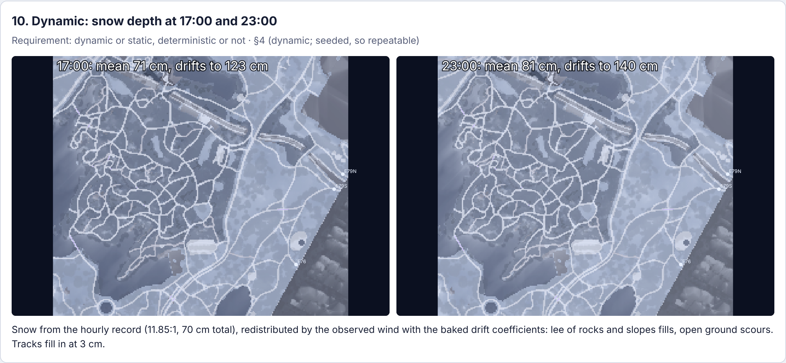

Snow from the hourly record (11.85:1, 70 cm total), redistributed by the observed wind with the baked drift coefficients: lee of rocks and slopes fills, open ground scours. Tracks fill in at 3 cm.

## 11. Obstacles

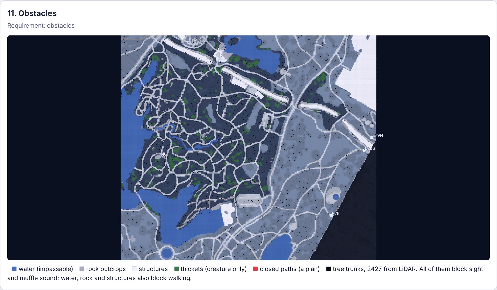

water (impassable) rock outcrops structures thickets (creature only) closed paths (a plan) tree trunks, 2427 from LiDAR. All of them block sight and muffle sound; water, rock and structures also block walking.

## 12. Hindrances and affordances: every intervention has two sides

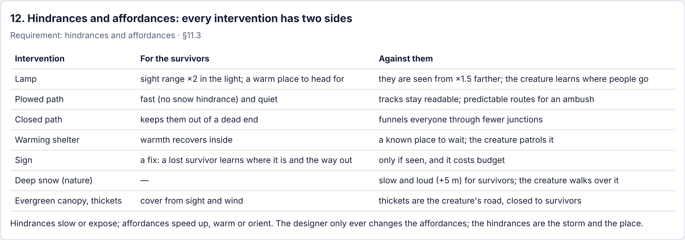

Hindrances slow or expose; affordances speed up, warm or orient. The designer only ever changes the affordances; the hindrances are the storm and the place.

## 13. Manual mode: side by side, and the lineage

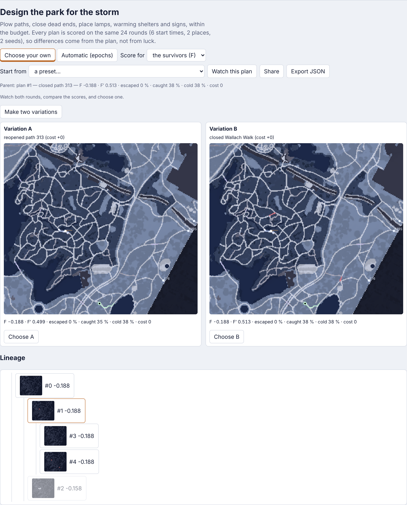

Two variations of the parent plan play the same round side by side and are scored on the 24-round suite; the chosen one becomes the parent. Every plan tried is in the lineage tree.

## 14. Automatic mode: the fitness curve and the best plan

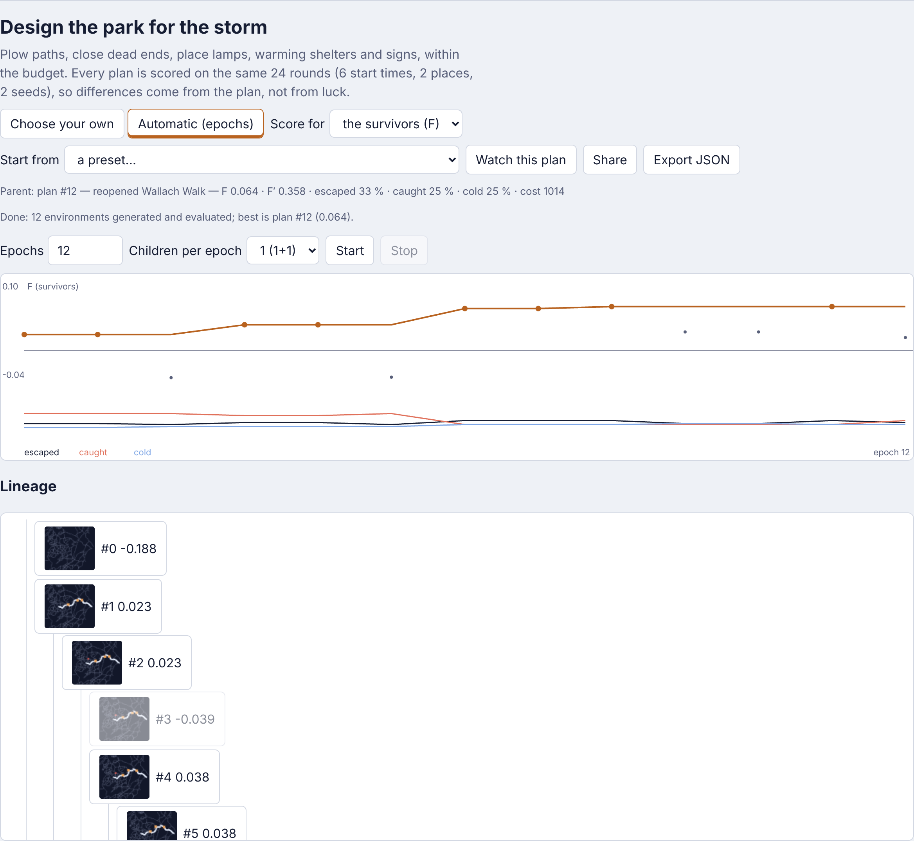

A (1+1) evolution strategy from Plan B, 12 epochs, each child scored on the same 24 rounds. Done: 12 environments generated and evaluated; best is plan #12 (0.064).

## 15. Secondary function: the real night, and tonight

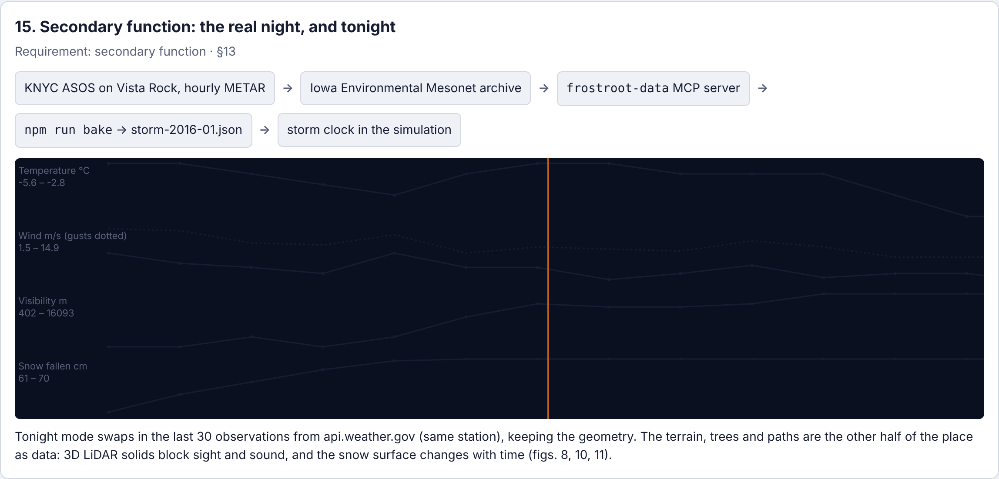

Tonight mode swaps in the last 30 observations from api.weather.gov (same station), keeping the geometry. The terrain, trees and paths are the other half of the place as data: 3D LiDAR solids block sight and sound, and the snow surface changes with time (figs. 8, 10, 11).
