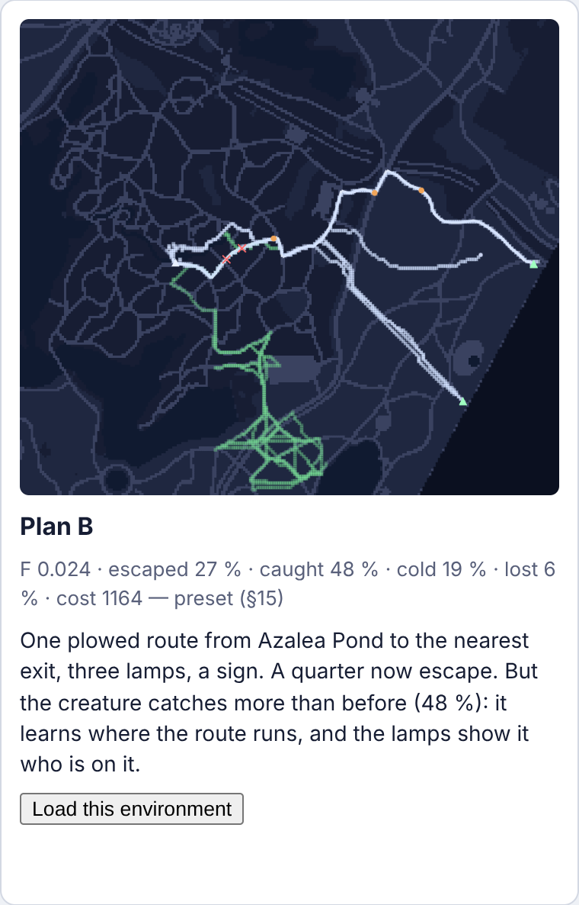
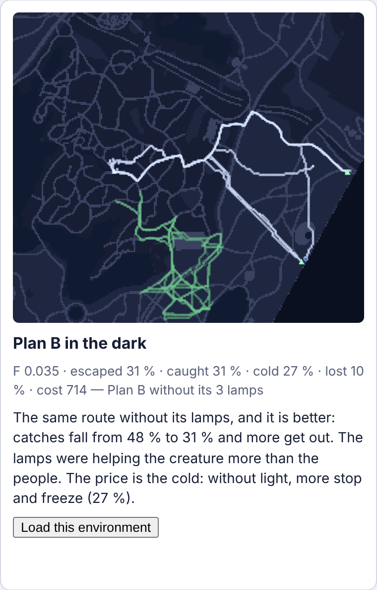
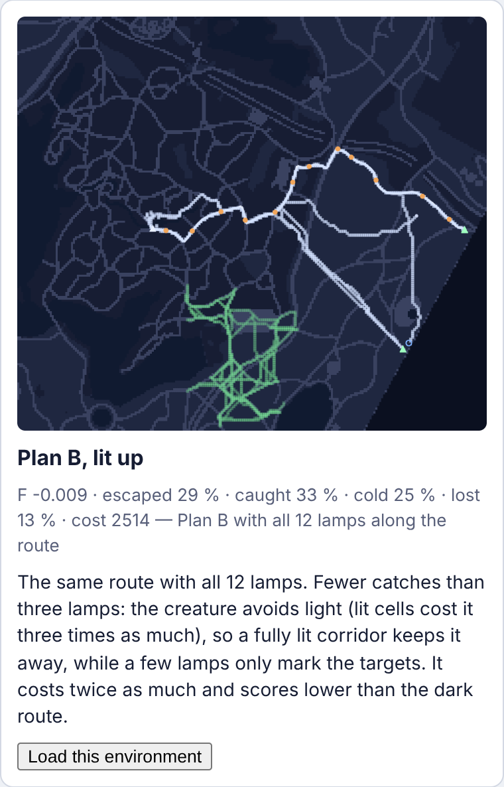
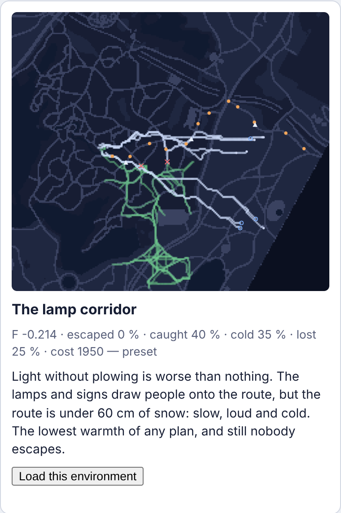
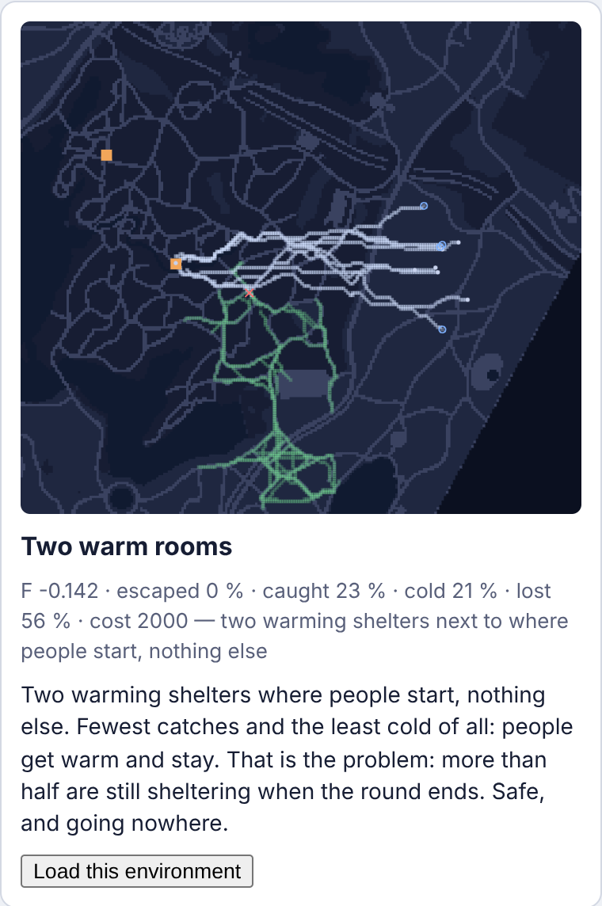
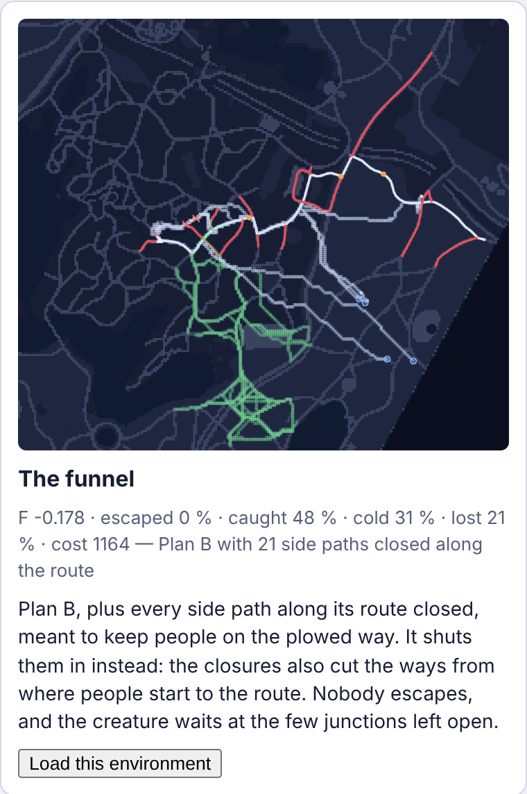
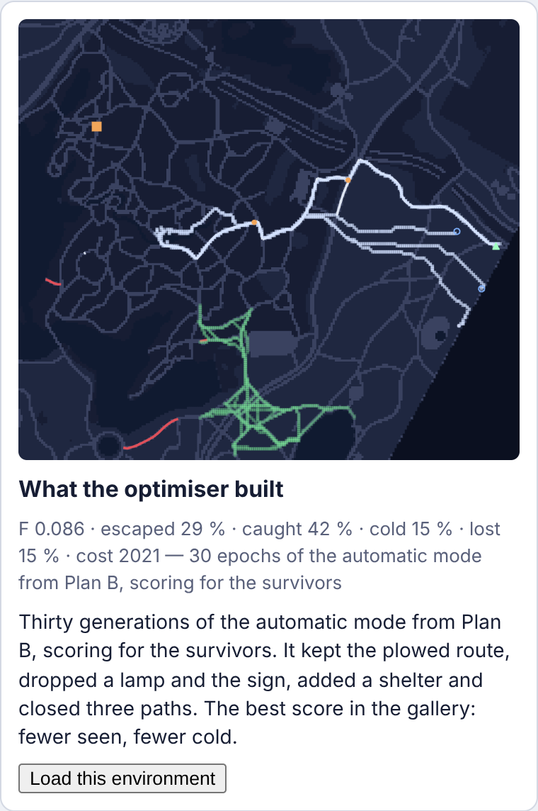
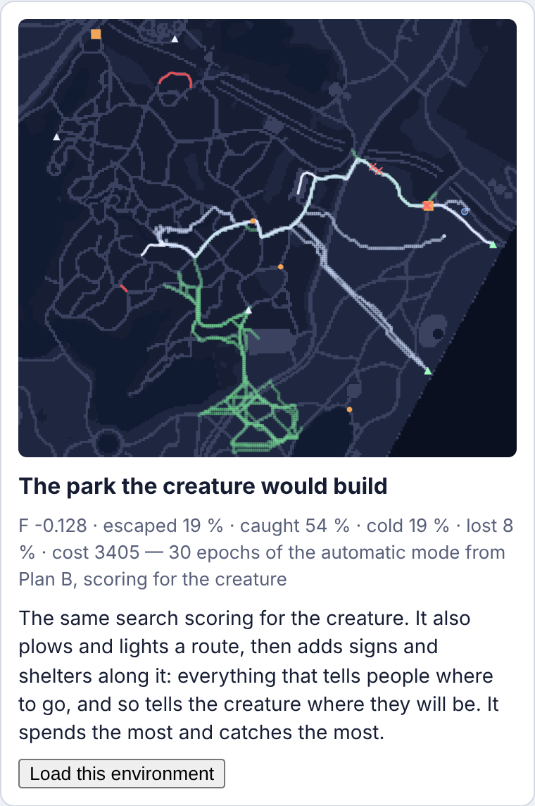
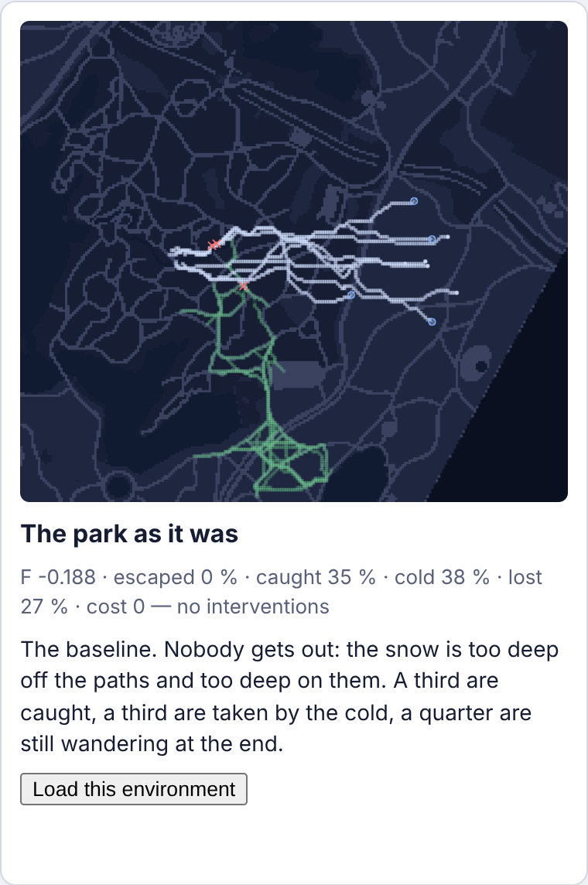

# Gallery of generated environments (ROADMAP M8.4)

Built by `node tools/build-gallery.mjs` (scores on the 24-round suite, heat maps on the first night); images by `npm run diagrams`. Map key: pale = where survivors walked, green = where the creature went; ▲ escaped, ✕ caught, ○ taken by the cold, • still lost; white = plowed, red = closed, orange = lamps and shelters, pale triangles = signs.

## Plan B

One plowed route from Azalea Pond to the nearest exit, three lamps, a sign. A quarter now escape. But the creature catches more than before (48 %): it learns where the route runs, and the lamps show it who is on it.

*preset (§15).* F 0.024 · escaped 27 % · caught 48 % · cold 19 % · lost 6 % · cost 1164. On the page: Gallery → "Plan B" → Load this environment.

## Plan B in the dark

The same route without its lamps, and it is better: catches fall from 48 % to 31 % and more get out. The lamps were helping the creature more than the people. The price is the cold: without light, more stop and freeze (27 %).

*Plan B without its 3 lamps.* F 0.035 · escaped 31 % · caught 31 % · cold 27 % · lost 10 % · cost 714. On the page: Gallery → "Plan B in the dark" → Load this environment.

## Plan B, lit up

The same route with all 12 lamps. Fewer catches than three lamps: the creature avoids light (lit cells cost it three times as much), so a fully lit corridor keeps it away, while a few lamps only mark the targets. It costs twice as much and scores lower than the dark route.

*Plan B with all 12 lamps along the route.* F -0.009 · escaped 29 % · caught 33 % · cold 25 % · lost 13 % · cost 2514. On the page: Gallery → "Plan B, lit up" → Load this environment.

## The lamp corridor

Light without plowing is worse than nothing. The lamps and signs draw people onto the route, but the route is under 60 cm of snow: slow, loud and cold. The lowest warmth of any plan, and still nobody escapes.

*preset.* F -0.214 · escaped 0 % · caught 40 % · cold 35 % · lost 25 % · cost 1950. On the page: Gallery → "The lamp corridor" → Load this environment.

## Two warm rooms

Two warming shelters where people start, nothing else. Fewest catches and the least cold of all: people get warm and stay. That is the problem: more than half are still sheltering when the round ends. Safe, and going nowhere.

*two warming shelters next to where people start, nothing else.* F -0.142 · escaped 0 % · caught 23 % · cold 21 % · lost 56 % · cost 2000. On the page: Gallery → "Two warm rooms" → Load this environment.

## The funnel

Plan B, plus every side path along its route closed, meant to keep people on the plowed way. It shuts them in instead: the closures also cut the ways from where people start to the route. Nobody escapes, and the creature waits at the few junctions left open.

*Plan B with 21 side paths closed along the route.* F -0.178 · escaped 0 % · caught 48 % · cold 31 % · lost 21 % · cost 1164. On the page: Gallery → "The funnel" → Load this environment.

## What the optimiser built

Thirty generations of the automatic mode from Plan B, scoring for the survivors. It kept the plowed route, dropped a lamp and the sign, added a shelter and closed three paths. The best score in the gallery: fewer seen, fewer cold.

*30 epochs of the automatic mode from Plan B, scoring for the survivors.* F 0.086 · escaped 29 % · caught 42 % · cold 15 % · lost 15 % · cost 2021. On the page: Gallery → "What the optimiser built" → Load this environment.

## The park the creature would build

The same search scoring for the creature. It also plows and lights a route, then adds signs and shelters along it: everything that tells people where to go, and so tells the creature where they will be. It spends the most and catches the most.

*30 epochs of the automatic mode from Plan B, scoring for the creature.* F -0.128 · escaped 19 % · caught 54 % · cold 19 % · lost 8 % · cost 3405. On the page: Gallery → "The park the creature would build" → Load this environment.

## The park as it was

The baseline. Nobody gets out: the snow is too deep off the paths and too deep on them. A third are caught, a third are taken by the cold, a quarter are still wandering at the end.

*no interventions.* F -0.188 · escaped 0 % · caught 35 % · cold 38 % · lost 27 % · cost 0. On the page: Gallery → "The park as it was" → Load this environment.
