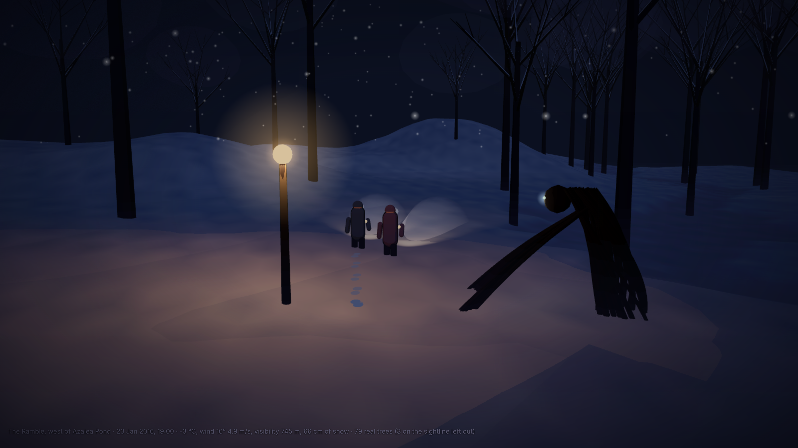

# 美术风格样张（M5.1）

**画面**：Azalea Pond 西边的小路（§15 的出生点），2016 年 1 月 23 日 19:00。两个幸存者打着手电往东走，身后是脚印；路边一盏路灯；右边林子里，根须构成的怪物侧身看着他们。可以打开 [`../style-frame.html`](../style-frame.html) 实时渲染（同一份数据、同一套代码 `src/render/kit.js`、`src/render/palette.js`）。

## 哪些来自数据（不能编）

| 画面里 | 来源 |
|---|---|
| 地形起伏 | 2017 年 NYC LiDAR 地面高程（双线性插值，1 m 网格） |
| 79 棵树的位置、高度、树冠和树干粗细 | 2017 年 LiDAR 点云提取的单株树（落叶，所以一月份光秃秃） |
| 积雪 66 cm、风吹出的雪堆 | 19:00 的累计降雪 × 每格的漂移系数；结冰的池塘上也有雪 |
| 雾 | 记录的能见度 745 m：消光系数 σ = 3.912 / V（在能见距离处对比度剩 2%） |
| 飘雪的密度 | 19:00 的降雪速度（约 2 cm/h） |
| 路、路灯所在的路段 | OSM 路网（路灯放在最近的路段上） |

唯一的取舍：镜头和人物之间视线上的 3 棵树没画（其余都在真实位置、真实大小），否则前景全是树干。

## 风格化的部分

- **色板**（`src/render/palette.js`，CSS 里同名）：夜空 `#0b1020`、雾 `#2a3150`、雪亮面 `#dfe6f3` / 中间 `#a9b6d1` / 阴影 `#56607e`；**暖橙 `#f2a65a` 只用在光上**（路灯、手电、取暖棚）——暖光等于安全；怪物的眼睛是冷的病态绿白 `#c8ffd8`，永远不会被读成"安全"。
- **着色**：三阶卡通渐变（MeshToon），加一圈深色描边（反面外壳），夜里剪影清楚。
- **雪**：手绘感的细微颗粒（低频噪声调亮度），雪堆顶更亮，脚印是一串浅凹。
- **树**：程式化的冬树：渐细的树干、向上散开的枝杈、枝上一线积雪、一层很淡的树冠雾；常绿树是叠起的圆锥（这一带只有几棵）。
- **人**：圆润、没有面部细节的冬装人形，围巾一点颜色；体温用呼出的白气表示（M5.2 里随体温变浓变淡），不画血条。
- **怪物**：原创——几十根根须从雪里盘旋上来，聚成驼背的一团，根须向四周铺在雪上，一对发光的眼睛，背后一点冷色边光让轮廓从林子里分出来。

## 参考方向（3–5 个，都是氛围和手法的参考，不临摹任何具体作品或角色）

1. **木刻 / 版画的雪夜**：大块平涂的明暗、有限的颜色、线条清楚的树干剪影。这决定了卡通渐变和描边。
2. **北欧绘本的冬夜**：冷蓝和灰紫的底，一处暖光就是全画面的焦点，人物小而可爱，环境大而安静。
3. **日本浮世绘的雪景（公有领域的江户时代版画）**：飘雪用简单的白点，远景被雪雾吃掉，留白多。
4. **桌面立体模型（diorama）**：略高的俯视角、真实地形当底座，二维地图和三维视图能对得上。
5. **民间传说里的森林精怪**：怪物是"森林自己长出来的东西"，用自然的材料（根、泥、雪）而不是怪兽的解剖结构，可怕在于看不清。

## 第二版（Ryan 的反馈之后，D-031）

方向确认，但要更恐怖。改了：曝光和环境光降低，暗部更深，加贴地雾、暗角和颗粒；怪物改成又高又瘦、向前弯、长臂伸向幸存者、头小眼小、根须在雪上爬；人物比例拉长。视角：默认第三人称（更客观，适合观察 agent），第一人称作为可选的沉浸模式。

## 第一版时的问题（已回答）

- 整体方向（冷夜 + 唯一的暖光、卡通渐变 + 描边）可以吗？
- 怪物的可怕程度：现在是"剪影 + 发光的眼睛"，要更可怕还是更童话？
- 镜头：这种略高的第三人称俯视作为默认视角？另一个是正上方的二维地图。
- 已知的粗糙处，M5.2 会改：手电光束还偏弱、人物比例偏矮胖、近处的雪面在路灯下偏粉白。
